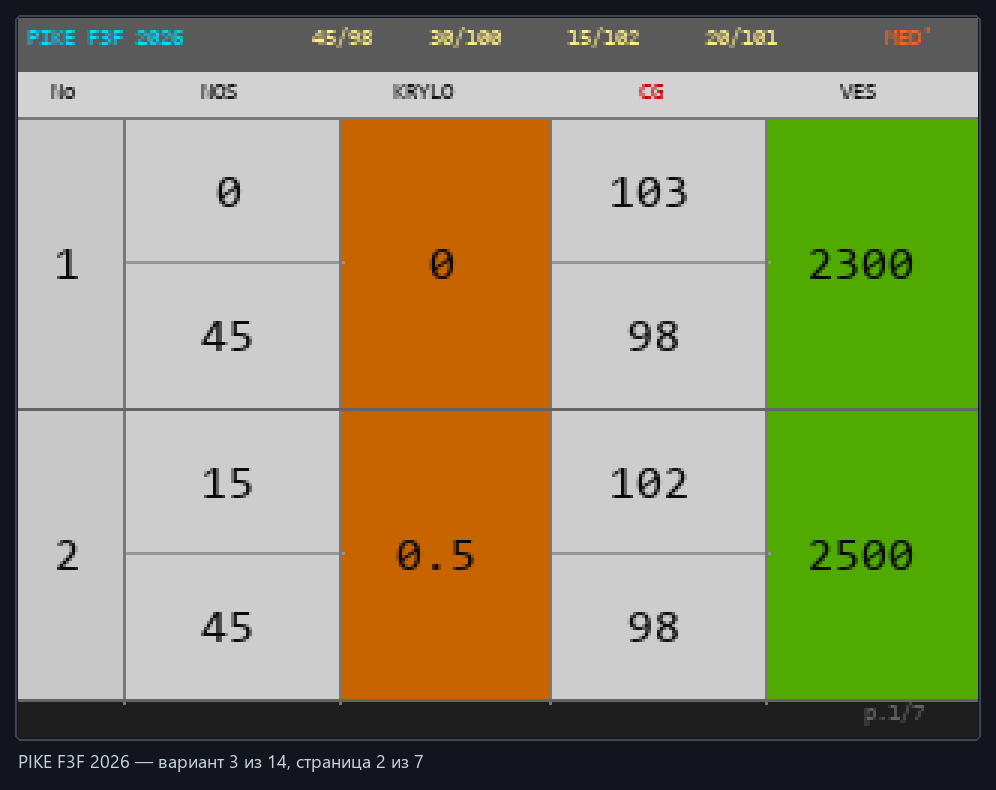
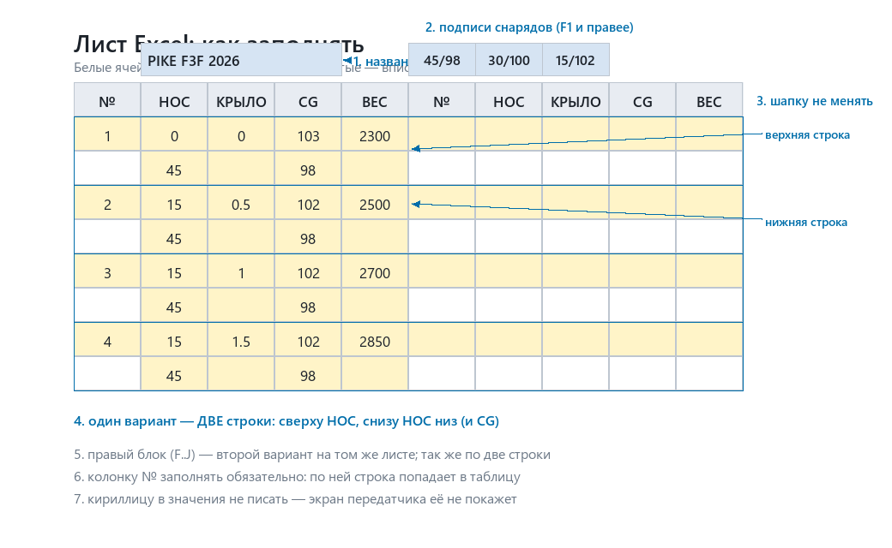
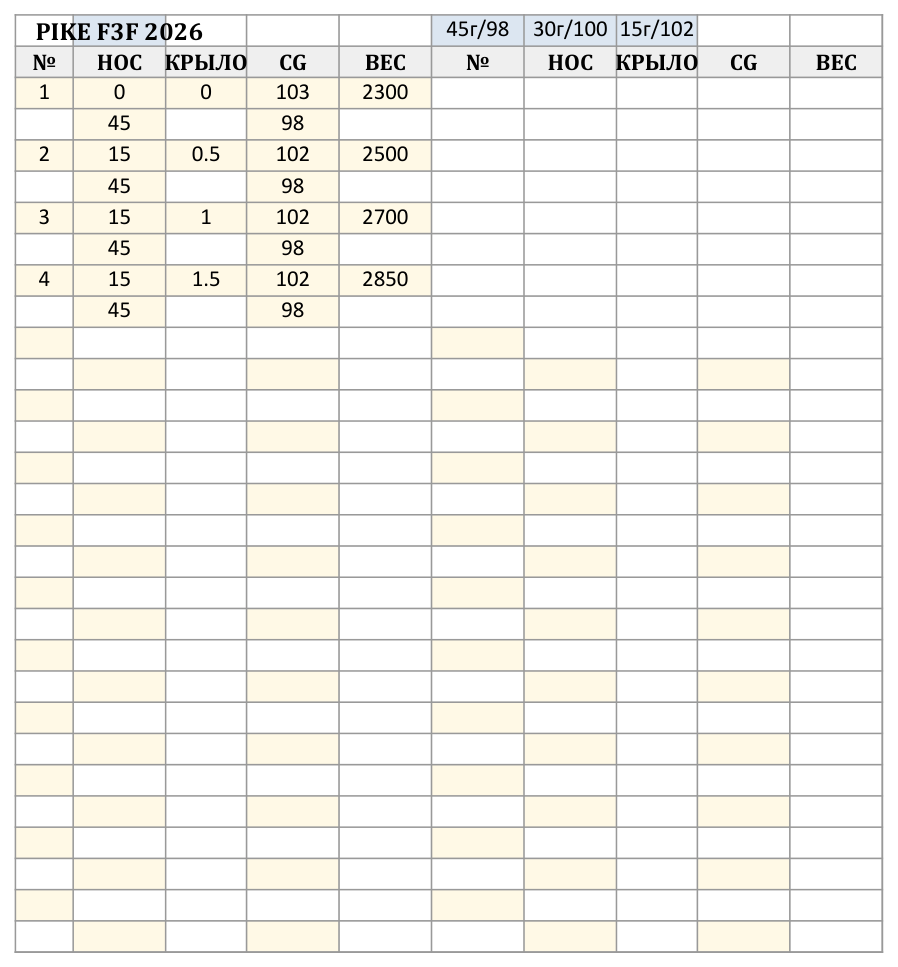
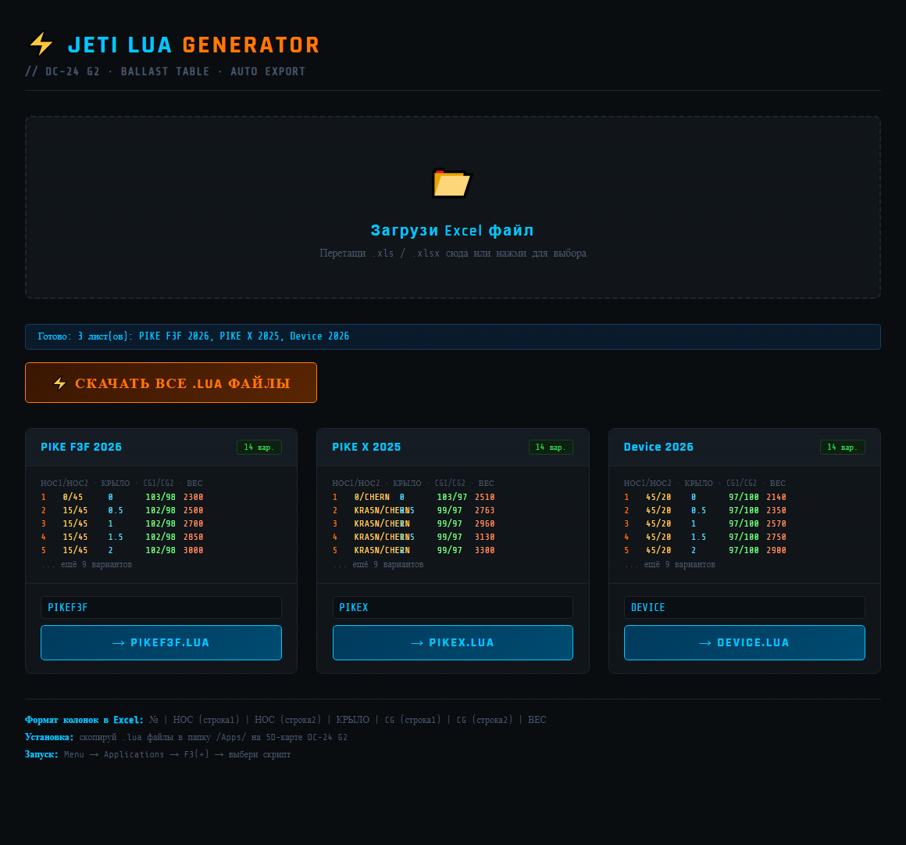
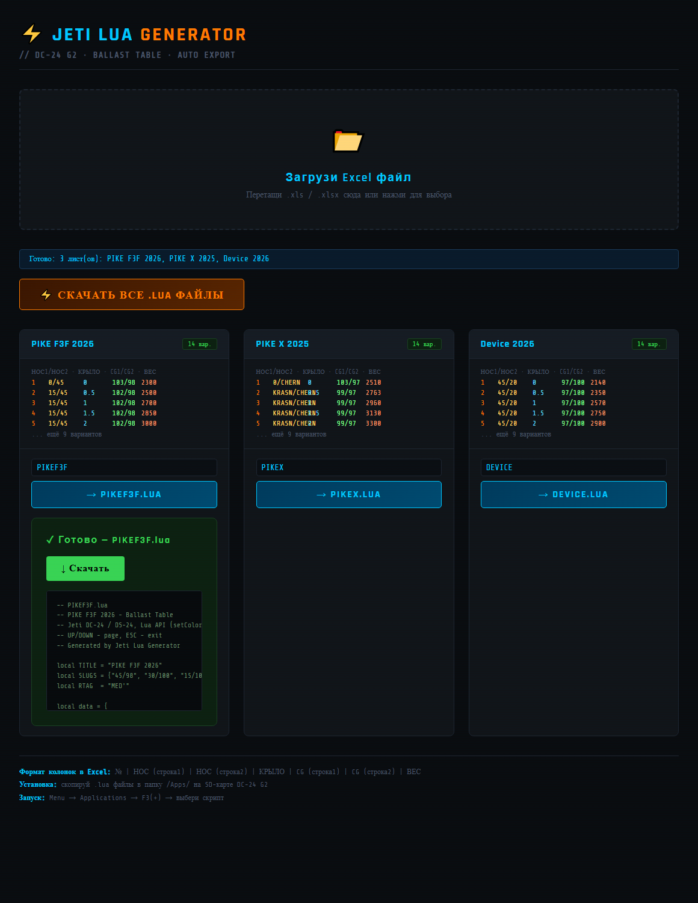

# JETI Ballast Generator — таблицы балласта для DC-24

Генератор Lua-приложений для передатчиков **Jeti DC-24 / DS-24** из обычной
Excel-таблицы. На экране передатчика — таблица вариантов загрузки:
**№ / НОС / КРЫЛО / CG / ВЕС**, по два варианта на страницу, листание UP / DOWN.

Ничего устанавливать не нужно: генератор — один HTML-файл, работает в браузере.

**[▶ Открыть генератор](https://permyakov344-png.github.io/jeti-ballast-generator/generator/jeti_lua_generator.html)**
·
**[⬇ Скачать всё одним архивом](https://github.com/permyakov344-png/jeti-ballast-generator/releases/latest)**



---

## Скачать и запустить

| Что | Ссылка | Зачем |
|---|---|---|
| **Всё сразу** | [`jeti-ballast-generator.zip`](downloads/jeti-ballast-generator.zip) | Распаковать в любую папку, открыть HTML |
| Генератор | [`jeti_lua_generator.html`](generator/jeti_lua_generator.html) | Открыть двойным щелчком |
| Шаблон таблицы | [`ballast_template.xlsx`](templates/ballast_template.xlsx) | Пустая форма с примерами |
| Готовые скрипты | [`PIKEF3F.lua`](output/PIKEF3F.lua) · [`PIKEX.lua`](output/PIKEX.lua) · [`DEVICE26.lua`](output/DEVICE26.lua) | Сразу на SD-карту |

В архиве рядом с HTML лежит `xlsx.full.min.js` — библиотека чтения Excel.
Без неё генератор попробует взять её из интернета, поэтому для работы офлайн
держите оба файла в одной папке.

---

## Как пользоваться

### 1. Заполнить таблицу

Возьмите `ballast_template.xlsx`. Внутри лист «Инструкция» и два примера.
Жёлтым подсвечено то, что нужно вписать.



| Где | Что |
|---|---|
| `B1` | Название модели — попадёт в шапку экрана и в имя файла |
| `F1` и правее | Подписи снарядов: `45г/98`, `30г/100` |
| Строка 2 | Шапка `№ \| НОС \| КРЫЛО \| CG \| ВЕС` — слева A..E, справа F..J |
| Строка 3 и далее | **Две** строки на вариант: верхняя — замер, нижняя — второй НОС / CG |

Один лист = одна модель. Один лист вмещает два варианта в ряд: левый блок
с колонки `A`, правый — с колонки `F`.



### 2. Перетащить файл в генератор

Откройте `jeti_lua_generator.html` и перетащите `.xls` или `.xlsx`
в пунктирную рамку.



### 3. Скачать .lua

В поле перед кнопкой можно поправить имя файла: **до 8 символов, только
латиница и цифры** — `PIKEF3F`, `PIKEX`, `DEVICE26`. Кнопка **«Скачать все»**
отдаёт сразу все модели из файла.



### 4. Положить на SD-карту

1. Скопировать `.lua` в папку `/Apps/` на карте передатчика.
2. На передатчике: **Menu → Applications** → выбрать скрипт.
3. **UP / DOWN** — листать страницы, **ESC** — выход.

---

## Правила заполнения

- Колонка `№` обязательна: по ней генератор находит вариант.
- Кириллицу в значения **не писать** — передатчик её не отображает.
  Знакомые слова сокращаются сами: `красный → KRASN`, `черный → CHERN`,
  `45г/98 → 45/98`.
- Листы без вариантов (например «Расчет») пропускаются.
- Если значение шире ячейки, оно рисуется мелким шрифтом.

---

## Что внутри репозитория

```
index.html                     страница-инструкция (GitHub Pages)
downloads/                     архив и файлы для скачивания
generator/jeti_lua_generator.html   генератор для браузера
generator/xlsx.full.min.js     библиотека чтения Excel (офлайн)
templates/ballast_template.xlsx     пустой шаблон для заполнения
templates/ballast_template.xls      исходная таблица как эталон структуры
data/zagluzka_2026_v2.xls      данные, на которых собраны примеры
data/names.json                «имя листа → имя .lua»
output/*.lua                   готовые скрипты
preview/*.png                  превью экрана 320×240
docs/img/*.png                 картинки для инструкции
docs/КАК-ПОЛЬЗОВАТЬСЯ.txt      текстовая инструкция внутри архива
reference/                     старые версии и исходный генератор (для истории)
tools/                         генератор для командной строки и проверки
```

### Командная строка (необязательно)

Тот же результат без браузера:

```bash
pip install xlrd openpyxl
python tools/generate.py data/zagluzka_2026_v2.xls output data/names.json
```

`data/names.json` — необязательное соответствие «имя листа → имя файла»
(полезно, когда авто-имя обрезается: `DEVICE 2026` → `DEVICE`, а нужно `DEVICE26`).

### Проверка без передатчика

```bash
pip install lupa pillow
python tools/test_lua.py output        # прогон на заглушках Jeti API + листание
python tools/check_layout.py output    # текст не вылезает за 320×240 и не наезжает
python tools/preview.py output         # PNG экрана в preview/
```

`test_lua.py` специально падает на `lcd.setFont`, `lcd.color`, `lcd.RGB`,
`lcd.drawFilledRect` — этих функций в API Jeti нет, и именно из-за них старые
скрипты не запускались на передатчике.

### Пересборка служебных файлов

```bash
python tools/build_html.py         # HTML из tools/generator.js
python tools/make_template.py      # templates/ballast_template.xlsx
python tools/make_downloads.py     # downloads/ (zip + отдельные файлы)
python tools/make_docs_images.py   # картинки (нужен локальный сервер и браузер)
python tools/make_fill_scheme.py   # схема заполнения таблицы
```

Для картинок генератора нужен запущенный локальный сервер:

```bash
python -m http.server 8765 --bind 127.0.0.1
```

---

## Частые проблемы

| Симптом | Причина |
|---|---|
| Вместо названия пусто | Кириллица в названии модели — пишите латиницей |
| Строка не попала в таблицу | Пустая колонка `№` |
| Скрипта нет в Applications | Файл не в `/Apps/`, имя длиннее 8 символов или не `.lua` |
| `attempt to call nil` | Скрипт собран под другой API — перегенерируйте этим генератором |

---

## Лицензия

MIT. Использование на свой риск: проверяйте CG и веса перед полётом.
